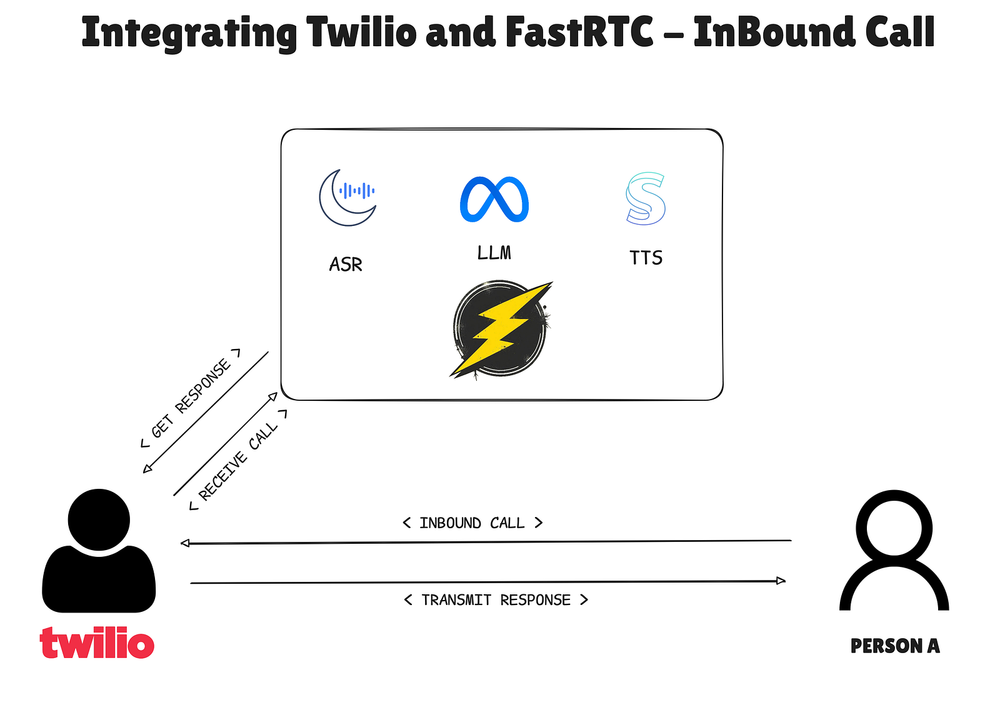
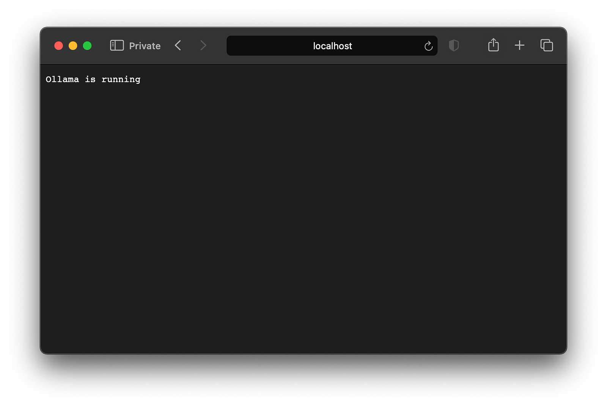
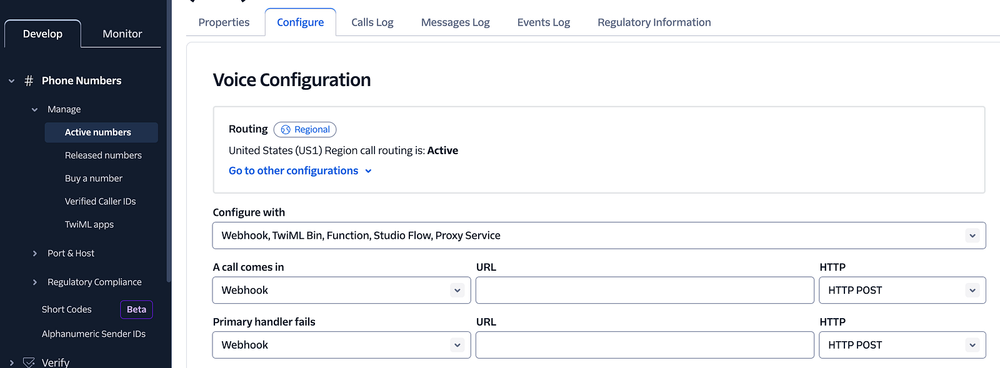
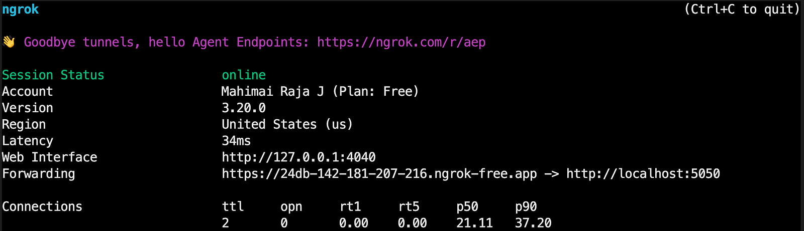
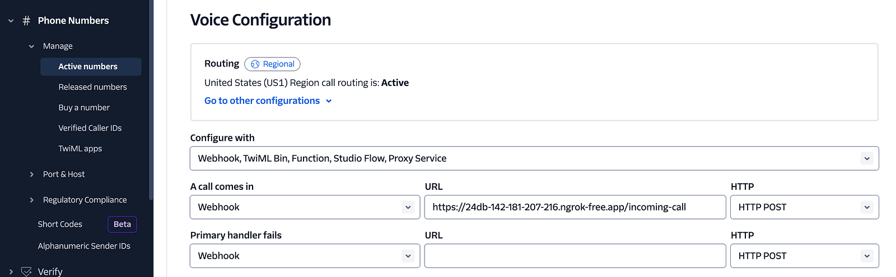

Since, the release of OpenAI Real Time API the voice agent services like Vapi, Retell AI got boomed. It unlocked many potential use cases like customer support, retails marketing, customer follow ups, etc. However these platforms do not provide fully customizable experience. Although, we can build a Voice Based Agent from scratch it needs a good understanding of WebRTC protocol which is very tricky in developers perspective. Thats were we can go with any of VoIP service providers like Twilio they provide phone numbers and routing services. Underneath they take care of the [TURN servers](https://getstream.io/glossary/turn-server/). Twilio uses [TwiML](https://www.twilio.com/docs/voice/twiml) for more natural voice results programatically.

But the main issue with these platforms were the data residency and limited model options also the pricing. Here comes [FastRTC](https://fastrtc.org) an easy to integrate and more customizable framework by [Freddy Boulton](https://github.com/freddyaboulton) from Hugging Face 🤗.

------------------------------------------------------------------------



*Fig 1. System Diagram*

Let us see an interesting use case using Twilio.

### Prerequisites

1\. If not, [download](https://ollama.com/download) Ollama cli and pull the model. Here, I am using llama3.2 3B. You choose any of instruct models from the [list](https://ollama.com/search)

```bash
$ brew install ollama
```

2\. Pull your desired model

```bash
$ ollama pull llama3.2
```

Verify ollama is up by visiting — [http://localhost:11434](http://localhost:11434)



3\. Create/Login to your Twilio Dashboard. If you are only testing don’t worry Twilio offers \$15 to everyone for testing. Head to phone numbers section

- Buy a phone number and check the configuration page. You should see something like below.



*Fig 2. Twilio Configuration Dashboard*

\[ Optional \] If you are running this on local machine use NGROK to expose the service to internet.

- Install ngrok — for other platforms check [this](https://ngrok.com/downloads/)

```bash
$ brew install ngrok
```

- Add your ngrok auth token — [sign up](https://ngrok.com/signup?ref=downloads) for free account

```bash
$ ngrok config add-authtoken <token>
```

- Expose your port, remember the same port we would be hosting our service

```bash
$ ngrok http 5050
```



*Fig 3. Sample NGROK Terminal View*

Copy the url shown in the termal by ngrok, something like this [https://24db-142-181-207-216.ngrok-free.app](https://24db-142-181-207-216.ngrok-free.app) You will need this url at later part to configure your Twilio Phone Number.

4\. Head to the project directory and let's start coding.

- Install FastRTC and dependencies

```bash
$ uv add fastrtc"[vad,stt,tts]" twilio ollama python-dotenv
```

5\. Create new file `main.py`

a\. Import the necessary packages

```python
import os
from fastrtc import ReplyOnPause, Stream, get_stt_model, get_tts_model
from fastapi import FastAPI, WebSocket, Request
from ollama import Client
```

b\. Define configuration variables

```python
OLLAMA_URL = os.getenv('OLLAMA_URL', 'http://localhost:11434')
OLLAMA_MODEL_NAME = os.getenv('OLLAMA_MODEL_NAME', 'llama3.2')

SYSTEM_MESSAGE = """You are a voice assistant that can help with anything you need.
Keep the converation more humorous and engaging.

- Maintain a fun, lighthearted vibe—say things like “Umm...”, “Well...”, or “I mean...” 
- Keep responses concise, as it's a voice conversation—avoid long monologues.
"""
```

c\. Initialize FastAPI and Models

```python
# Initialize FastAPI app
app = FastAPI()

# Initialize STT and TTS models
stt_model = get_stt_model()
tts_model = get_tts_model()
# Initialize Ollama client
client = Client(
    host=OLLAMA_URL,
    headers={'x-some-header': 'some-value'}
)
```

d\. Define the echo function that will be used to handle incoming audio

```python
def echo(audio):
    prompt = stt_model.stt(audio)

    response = client.chat(
            model=OLLAMA_MODEL_NAME,
            messages=[
                {"role": "system", "content": SYSTEM_MESSAGE},
                {"role": "user", "content": prompt}
            ]
        )
    
    response_text = response['message']['content']

    for audio_chunk in tts_model.stream_tts_sync(response_text):
        yield audio_chunk
```

e\. Initialize the FastRTC’s Media Stream

```python
stream = Stream(ReplyOnPause(echo), modality="audio", mode="send-receive")
```

f\. Define the root route for the FastAPI app

```python
@app.api_route("/incoming-call", methods=["GET", "POST"])
async def handle_incoming_call(request: Request):
    """Handle incoming call and return TwiML response to connect to Media Stream."""
    response = await stream.handle_incoming_call(request)
    return response
```

g\. Define the handler route for Media Stream

```python
@app.websocket("/telephone/handler")
async def handle_media_stream(websocket: WebSocket):
    """Handle WebSocket connections between Twilio and Media Stream."""
    await stream.telephone_handler(websocket)
```

Well done! Now you have wrote code for real time conversational Voice Agent that can connect to a real phone number!

Now let’s host our API and connect it with Twilio

Go to the termial and run the FastAPI server using the below command

```bash
$ uvicorn app:app --host 0.0.0.0 --port 5050 
```

! Remember? We exposed the same port

Now go to Twilio — Phone Number — Active Numbers — Configure



*Fig 4. Twilio Configuration Dashboard*

Add the hosted NGROK uri with the `/incoming-call` tag

Something like this —

[https://24db-142-181-207-216.ngrok-free.app/incoming-call](https://24db-142-181-207-216.ngrok-free.app/incoming-call)

Hurry! Now voice agent is live and can be accessible from anywhere in the world, in your mobile phone.

------------------------------------------------------------------------

A sincere thanks to FastRTC and to all the contributors for making this amazing framework!

Wondering if you are building or have an idea to build something crazy with FastRTC or Voice message feel free to [tag me](https://github.com/mahimairaja) to your repo — [Github](https://github.com/mahimairaja)

If you find this post valuable, share it with your network! See you

------------------------------------------------------------------------

REFERENCES

\[ 1 \] Source Code: [https://github.com/mahimairaja/fastrtc-twilio-ollama](https://github.com/mahimairaja/fastrtc-twilio-ollama)

\[ 2 \] FastRTC: [https://fastrtc.org/](https://fastrtc.org/)

\[ 3 \] Twilio Voice: [https://www.twilio.com/docs/voice](https://www.twilio.com/docs/voice)

\[ 4 \] Ollama: [https://ollama.com/](https://ollama.com/)

\[ 5 \] Moonshine ASR: [https://github.com/usefulsensors/moonshine](https://github.com/usefulsensors/moonshine)

\[ 6 \] Kokoro TTS: [https://kokorottsai.com/#featurelist](https://kokorottsai.com/#featurelist)

\[ 7 \] Llama 3.2 3B: [https://huggingface.co/meta-llama/Llama-3.2-3B](https://huggingface.co/meta-llama/Llama-3.2-3B)

\[ 8 \] FastAPI WS: [https://fastapi.tiangolo.com/advanced/websockets/](https://fastapi.tiangolo.com/advanced/websockets/)
