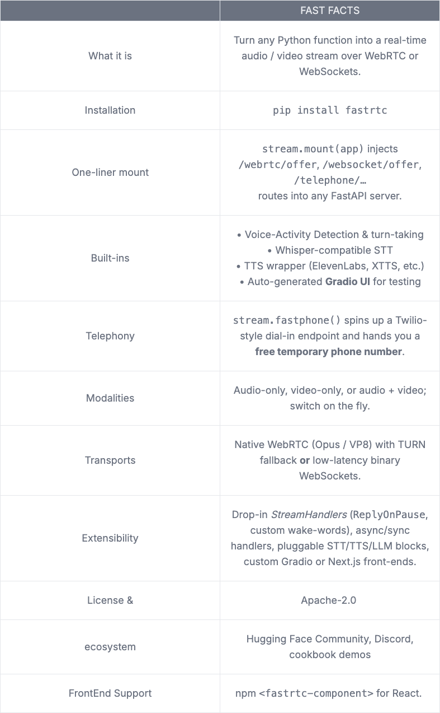
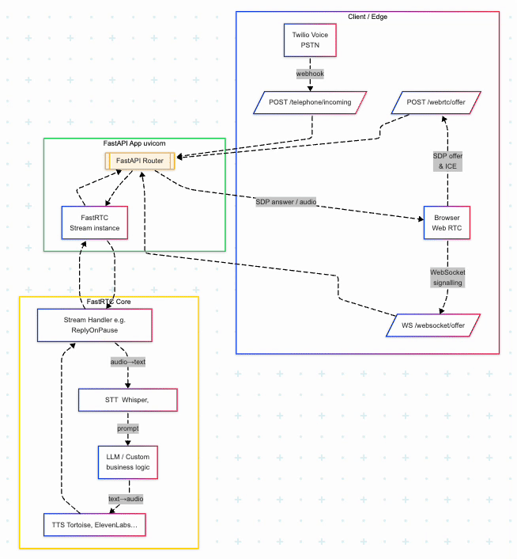

Have you ever wondered how this Voice AI solutions Today seamlessly interpret and respond to human queries? Would you believe that the first generations to experience and explore this real time Voice AI solutions handy from our handy devices. This was made possible only after hard works of renowned research groups, I am mentioning few here — ElevenLabs, OpenAI’s Whisper, [kyutai Labs](https://kyutai.org), Hugging Face and may Open Source Lead groups. Even today ( 27.05.2025 ) Resemble AI released a Open Souce SOTA Speech to Text model — [ChatterBox](https://huggingface.co/ResembleAI/chatterbox). It’s always fun and energizing to see new models everyday.

However, only in late 2024, mainstream developers got confident and started developing voice solutions — [vapi ai](https://vapi.ai), [retell ai](https://www.retellai.com), [voice flow](https://www.voiceflow.com) and so on…

In Blog post, let us see How [Freddy Boulton](https://github.com/freddyaboulton) from Hugging Face along with Open Source Contributors built FastRTC. Freddy Boulton has a major participation in development of Gradio Framework. I have tried my best to keep it simple as possible, even if are just starting or beginner don’t worry every section is kept detailed and you are always welcome to drop your questions in the comments sections, I would address them as early. By the end of this Blog Post you should be able to have a idea of how an enterprise level Voice Solutions work, and I assure, you will be able to raise a PR to FastRTC Repository. Below is the list of topics covered in this article, feel free to skip to the section you are looking for.

> **The future of AI is not about replacing humans, it’s about augmenting human capabilities — **Sundar Pichai, CEO of Google.

— — — — — — — — — — — — — — — — — — — — — — — — — — — — — — — — — — — — —

## Table of Contents:

1.  Why Real Time Matters in 2025
2.  The Problems FastRTC Solves
3.  FastRTC at a Glance
4.  Under the Hood: Architecture Primer
5.  Installation — Hello World

------------------------------------------------------------------------

## 1. Why Real Time Matters in 2025

Now-a-days having a real time data conversation is not a dream, it has become a basic need for every app involving multi-media. NVIDIA has remarkably invented dozen of consumer grade and enterprise GPUs. This has brought innovations to next level. Even, paved way for people to run Billion parameter models from their Laptop’s local host. This led to ventures kept standard at`500 ms rule` [stated in Hacker News](https://news.ycombinator.com/item?id=43899028&utm_source=chatgpt.com). Global market for [WebRTC was valued](https://www.fortunebusinessinsights.com/webrtc-market-109729) at USD 7.03 Billion in 2024, this signifies the growth in recent times.

Eventhough many closed source solutions exist’s, this tool has caught up with demand. People whoever using python for a long time would know that using webRTC inside python is like installing CUDA drive in your NVIDIA GPUs. TBH, FastRTC had did a very good job in stiching together WebRTC, FastAPI, VAD, STT, LLM, TTS and Twilio style telephony in one pythonic surface. That means a sad solo engineer sitting remote somewhere on earth like you and me now can ship a production-grade, bi-directional voice copilot over a weekend, not a quarter.

------------------------------------------------------------------------

## 2. The Problems FastRTC Solves

**a. The “Python ↔ WebRTC” Gap**  
Python developers typically use aiortc, a powerful but extremely low-level library that requires you to hand-roll SDP offers, ICE negotiation, media tracks, and concurrency plumbing, to meet WebRTC, the de facto standard for low-latency audio/video in browsers. There are “hundreds of lines of boilerplate before business logic starts,” this makes work harder even to an engineers with years of experience.

**b. Too Many Moving Pieces for One Engineer**  
Launching a voice-AI feature today means juggling:  
- **signalling endpoints** (HTTP + WebSocket)  
- **Media transport** (WebRTC / TURN servers)  
- **Voice Activity Detection** to know *when* to answer  
- **ASR + LLM + TTS** chain for the *what  
-* **A web UI** for testing, plus **telephony webhooks** if you want dial-in support.

**c. FastAPI Teams Weren’t “Real-Time Ready”**  
FastAPI provides instant JSON APIs, but we have to use Starlette websockets, CORB headers, and asyncio edge-cases when we need `/webrtc/offer` or `/websocket/offer`. For real-time streams, there was no “mount-and-go” counterpart.

**d. Prototype Latency Became the Competitive Metric**  
Since Whisper-class ASR and ElevenLabs-grade TTS became commodity (2023–24), *quality* is solved; the new moat is **how quickly you can ship a realtime UX**. Teams wasting weeks on plumbing lose the window.

## 3. FastRTC at a Glance



## 4. Under the Hood: Architecture Primer



*Fig. 1 Components of FastRTC*

To understand the flow, I have simply grouped the components into three group based on the functionalities.

1.  FastAPI App
2.  FastRTC Environment
3.  Client Interaction

## 5. Installation — Hello World

```python
from fastrtc import Stream, ReplyOnPause
from fastapi import FastAPI
import numpy as np
import uvicorn

def echo(audio: tuple[int, np.ndarray]):  # <— your business logic
    yield audio                           # simply echo back

stream = Stream(
    handler=ReplyOnPause(echo),           # wrap the logic
    modality="audio", 
    mode="send-receive",
)

app = FastAPI()
stream.mount(app)                         # inject WebRTC / WS / phone routes

if __name__ == "__main__":
    uvicorn.run(app, host="0.0.0.0", port=8000)
```

## FastRTC’s answer

- **One-Liner Mount:** `stream.mount(app)` injects all four required routes—WebRTC, WebSocket, FastPhone telephony—directly into your FastAPI server. [FastRTC](https://fastrtc.org/reference/stream/?utm_source=chatgpt.com)
- **Stream Abstraction:** *Any* Python function becomes a bidirectional media pipeline; FastRTC handles SDP, ICE, packetisation, buffering. [FastRTC](https://fastrtc.org/?utm_source=chatgpt.com)
- **Batteries Included:** Optional extras (`vad`, `stt`, `tts`) give pause detection, Whisper-style ASR, and TTS out of the box; a Gradio UI spins up automatically for local testing. [FastRTC](https://fastrtc.org/?utm_source=chatgpt.com)
- **Focus on Logic, Not Plumbing:** You write the handler that decides *what to say* — FastRTC owns *how to say it* in &lt;25 ms chunks.

Would you be interested in Part II ?

Comment below :)
