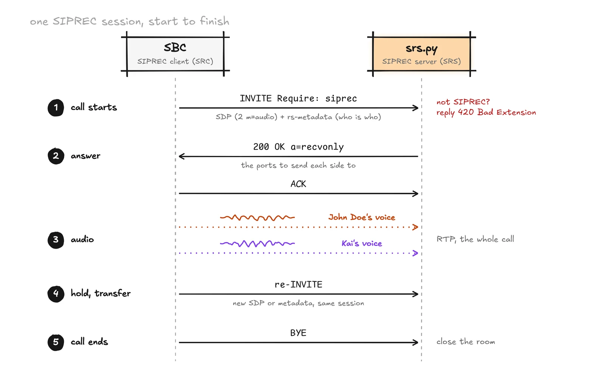
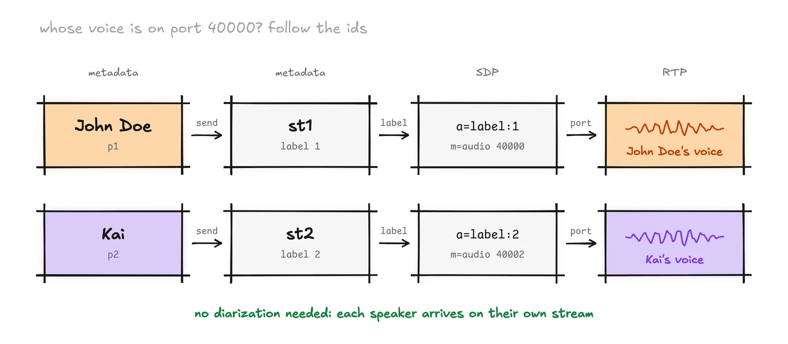
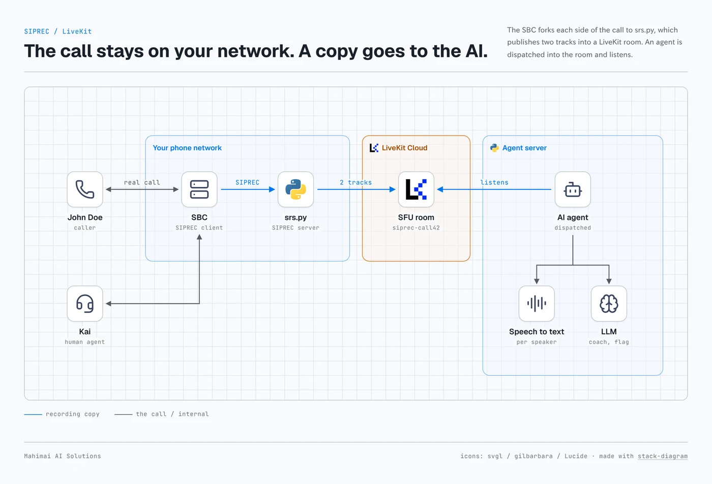
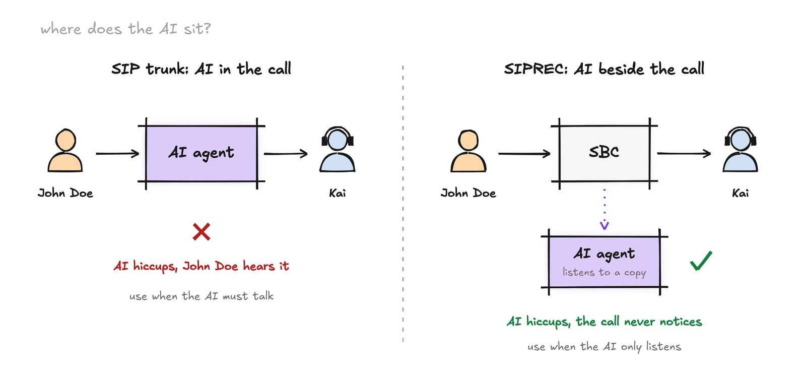

Sometimes the AI can't be in the call but still has to be part of the work. Sounds tricky, right? In high-compliance settings you often can't put an AI agent into the call at all. So what do you do?

## The problem

Your calls already run through a phone system you trust: a session border controller (SBC), a PBX, or a contact center platform. Now someone wants an AI to hear those calls live. Maybe it transcribes, coaches the agent, flags compliance risks, or writes the summary before the agent hangs up.

The obvious move is to put the AI in the call path. That is also the risky move. If your AI stack hiccups, the customer hears it.

SIPREC (SIP session recording, RFC 7866) is the other way. The call stays exactly where it is. The SBC sends a copy of each side of the call to a separate server, and your AI listens to that copy. If the copy breaks, the call does not.

This post explains how SIPREC works, shows what the SBC actually sends, and walks through a small Python server that receives SIPREC and publishes each side of the call into a LiveKit room, where any AI agent can pick it up. The code is tested end to end against a simulated SBC.

## What is SIPREC?

SIPREC is the IETF standard for recording SIP calls. The protocol is RFC 7866, and the metadata format (who is on the call, which audio belongs to whom) is RFC 7865.

There are two roles:

- **SRC (Session Recording Client).** The thing that forks the call. Usually your SBC (Cisco CUBE, Oracle/Acme Packet, Ribbon, AudioCodes) or the PBX.
- **SRS (Session Recording Server).** The thing that receives the copy. Traditionally a call recorder. In our case, a small server that hands the audio to AI.

The SRC opens a brand new SIP session to the SRS, separate from the real call. That separate session is the "recording session". The real call is the "communication session" and it is never touched.

## How a SIPREC session works

1. **The call starts.** John Doe calls in and the SBC connects him to Kai, a human agent in your contact center. Nothing unusual yet.
2. **The SBC opens the recording session.** It sends a SIP `INVITE` to the SRS. Two things mark it as SIPREC: a `Require: siprec` header and a `+sip.src` feature tag on the Contact. A server that does not speak SIPREC must reject it with `420 Bad Extension`.
3. **The INVITE carries two bodies.** One is SDP describing the audio streams. The other is XML metadata (`application/rs-metadata`) describing the participants.
4. **One audio stream per side.** Usually two `m=audio` lines: one for John Doe, one for Kai. Each has `a=sendonly` (the SBC only sends) and an `a=label`. The label is how the metadata says which stream is whose voice.
5. **The SRS answers.** It replies `200 OK` with its own SDP: the ports it will listen on, marked `a=recvonly`.
6. **Audio flows.** The SBC streams RTP to those ports for as long as the call lasts.
7. **Things change mid-call.** Hold, transfer, a codec switch or a new participant arrive as a re-INVITE or UPDATE with new SDP or new metadata.
8. **The call ends.** The SBC sends `BYE` on the recording session.



Keeping each side on its own stream is a big deal for AI. You get clean speaker separation for free, with no diarization model guessing who said what.

## What the SBC actually sends

Here is a trimmed SIPREC INVITE, close to what an SBC sends. It is the same shape as the example in RFC 7866.

```text
INVITE sip:srs@recorder.example.com SIP/2.0
Via: SIP/2.0/UDP sbc.example.com;branch=z9hG4bK74a
From: <sip:sbc@example.com>;tag=sbc1
To: <sip:srs@recorder.example.com>
Call-ID: call-42@sbc
CSeq: 1 INVITE
Require: siprec
Accept: application/sdp, application/rs-metadata
Contact: <sip:sbc@sbc.example.com>;+sip.src
Content-Type: multipart/mixed;boundary=b

--b
Content-Type: application/sdp

v=0
o=SBC 1 1 IN IP4 198.51.100.10
s=-
c=IN IP4 198.51.100.10
t=0 0
m=audio 40000 RTP/AVP 0 8
a=sendonly
a=label:1
m=audio 40002 RTP/AVP 0 8
a=sendonly
a=label:2

--b
Content-Type: application/rs-metadata
Content-Disposition: recording-session

<recording xmlns="urn:ietf:params:xml:ns:recording:1">
  <datamode>complete</datamode>
  <session session_id="s1"/>
  <participant participant_id="p1">
    <nameID aor="sip:+14165550100@example.com"><name>John Doe</name></nameID>
  </participant>
  <participant participant_id="p2">
    <nameID aor="sip:kai@example.com"><name>Kai</name></nameID>
  </participant>
  <stream stream_id="st1" session_id="s1"><label>1</label></stream>
  <stream stream_id="st2" session_id="s1"><label>2</label></stream>
  <participantstreamassoc participant_id="p1"><send>st1</send></participantstreamassoc>
  <participantstreamassoc participant_id="p2"><send>st2</send></participantstreamassoc>
</recording>
--b--

```

Read it bottom up: participant `p1` (John Doe) sends stream `st1`, stream `st1` has label `1`, and label `1` is the first `m=audio` line on port 40000. So the RTP on that stream is John Doe's voice. Real SBCs add vendor extensions (Cisco, Oracle and Ribbon all put extra call data in their own XML namespaces), but this core is standard.



## Build it: SIPREC into LiveKit in Python

The receiver does four jobs:

1. Speak just enough SIP to accept the recording session.
2. Read the SDP and metadata to learn which stream is which person.
3. Receive RTP and decode G.711 (PCMU or PCMA, which is what SBCs fork in almost every deployment) to PCM.
4. Publish each side as its own audio track in a LiveKit room named after the call.

Any LiveKit agent that joins the room now hears John Doe and Kai as two separate tracks, labeled by name.

The server is about 200 lines with two dependencies (`livekit==1.2.0`, `livekit-api==1.2.2`). The code, with a fake SBC to test it, is on GitHub at [mahimailabs/siprec-livekit](https://github.com/mahimailabs/siprec-livekit). Here are the parts that matter.



**Matching streams to speakers.** Parse the SDP for `m=audio` and `a=label`, then walk the metadata from participant to stream to label:

```python
speakers = {}
root = ET.fromstring(meta)
names = {}
for p in root.findall("r:participant", NS):
    n = p.find("r:nameID", NS)
    names[p.get("participant_id")] = n.findtext("r:name", default=n.get("aor"), namespaces=NS)
stream_label = {s.get("stream_id"): s.findtext("r:label", namespaces=NS)
                for s in root.findall("r:stream", NS)}
for a in root.findall("r:participantstreamassoc", NS):
    for sent in a.findall("r:send", NS):
        speakers[stream_label.get(sent.text)] = names.get(a.get("participant_id"))
# {"1": "John Doe", "2": "Kai"}

```

**One LiveKit track per side.** For each stream, create an audio source, publish it under the speaker's name, and open a UDP port for its RTP:

```python
await self.room.connect(LIVEKIT_URL, token)
for s in streams:
    name = speakers.get(s["label"]) or f"leg-{s['label']}"
    source = rtc.AudioSource(8000, 1)
    track = rtc.LocalAudioTrack.create_audio_track(name, source)
    await self.room.local_participant.publish_track(
        track, rtc.TrackPublishOptions(source=rtc.TrackSource.SOURCE_MICROPHONE)
    )
    port = next(RTP_PORTS)
    await loop.create_datagram_endpoint(lambda: LegToTrack(source), local_addr=("0.0.0.0", port))

```

**RTP to audio frames.** Strip the RTP header, decode each G.711 byte with a lookup table, and push 20 ms frames into the source in order:

```python
def datagram_received(self, data, addr):
    cc, pt = data[0] & 0x0F, data[1] & 0x7F
    offset = 12 + 4 * cc
    if data[0] & 0x10:  # header extension
        offset += 4 + 4 * struct.unpack("!H", data[offset + 2 : offset + 4])[0]
    table = DECODE.get(pt)  # 0 = PCMU, 8 = PCMA
    if table is None:       # comfort noise, DTMF events
        return
    payload = data[offset:]
    pcm = struct.pack(f"<{len(payload)}h", *(table[b] for b in payload))
    self.frames.put_nowait(rtc.AudioFrame(pcm, 8000, 1, len(payload)))

```

**The answer.** Reply with `a=recvonly` and the same labels, so the SBC knows where to send each side:

```text
m=audio 20000 RTP/AVP 0
a=rtpmap:0 PCMU/8000
a=recvonly
a=label:1
m=audio 20002 RTP/AVP 0
a=rtpmap:0 PCMU/8000
a=recvonly
a=label:2

```

### Does it work?

We tested it against a local LiveKit server with a script that plays the SBC: it sends the INVITE above, streams 8 seconds of RTP (a 440 Hz tone as John Doe, an 880 Hz tone as Kai), then hangs up. A second script joins the room as a listener and checks what arrives:

```text
[call42sbc] label 1 -> track 'John Doe' on RTP port 20000
[call42sbc] label 2 -> track 'Kai' on RTP port 20002
[call42sbc] 'John Doe': 400 RTP packets forwarded
[call42sbc] 'Kai': 400 RTP packets forwarded

track 'John Doe': 6.1s audio, rms 6283, peak at 440 Hz
track 'Kai': 6.1s audio, rms 6266, peak at 880 Hz

```

Each side arrives as its own named track, with the right audio on the right name. Point a LiveKit agent at room `siprec-<call id>` and it can transcribe, coach or summarize each speaker separately.

## Where SIPREC shows up

- **SBCs.** Cisco CUBE, Oracle Communications SBC (Acme Packet), Ribbon and AudioCodes all act as a SIPREC client. This is the most common place to turn it on.
- **AWS.** Amazon Chime SDK Voice Connector accepts SIPREC from your PBX or SBC and streams the audio into Kinesis Video Streams, so you can do this without running your own SRS.
- **Contact center recorders.** NICE (Engage, Uptivity) and Verint recorders accept SIPREC from an SBC; this is how most enterprise call recording already works.
- **Genesys Cloud.** Genesys Cloud does not offer SIPREC itself. With BYOC, the SBC in front of it can fork SIPREC to a recorder. For live audio straight from Genesys, AudioHook is the native route.

Check your exact SBC model and software version before you promise a customer anything. SIPREC support is often a licensed feature.

## SIPREC vs the other ways to get live call audio



| Approach | Where it fits | What you get | Watch out for |
| --- | --- | --- | --- |
| **SIPREC** | You own or control an SBC or PBX | Each side as a separate RTP stream, plus participant metadata | SBC config and licenses, SIP and RTP networking to your server |
| **Twilio Media Streams** | Calls already on Twilio | Base64 audio over a WebSocket | Twilio only |
| **Genesys AudioHook** | Genesys Cloud contact centers | Audio over a WebSocket, both sides | Genesys only |
| **SIP trunk into LiveKit** | You want the AI in the call, not beside it | The AI is a real participant | The AI is now in the call path |
| **OpenAI sideband** | You use OpenAI's realtime voice models | A server-side control channel to a live session | Controls the AI session; it is not a copy of the phone call |

Rule of thumb: if there is an SBC in the picture and the AI should only listen, SIPREC is the cleanest answer. If the AI needs to talk, you want a SIP trunk instead.

## The six things that break in production

The demo above is the happy path. These are what bite on real traffic:

1. **Transfers and re-INVITEs.** When Kai transfers John Doe, the SBC sends a re-INVITE, sometimes with new labels or a new participant in the metadata. Your SRS has to keep the same room and update who is speaking, not start over.
2. **Concurrent calls.** Each call needs two RTP ports and a LiveKit connection. Plan port ranges, file descriptors, and CPU for decoding at peak, not average, call volume.
3. **Failover.** SBCs ping the recorder with SIP `OPTIONS` and pick another when one does not answer. Run at least two SRS instances and decide what happens to a call already in progress when one dies. Also check whether recording is configured as optional or mandatory on the SBC: mandatory can drop real calls when your SRS is down.
4. **Codecs.** G.711 is the norm, but some SBCs offer G.729 or Opus. Your answer SDP should only accept codecs you can decode.
5. **Keeping the two sides in sync.** The two streams have separate RTP timestamps and can drift or arrive with gaps. If your AI needs a single timeline (for a combined transcript), align on arrival time and RTCP, not on packet counts.
6. **Recording vs listening.** If you store the audio, you are a call recorder, with the consent, retention and data residency rules that come with that. If you only analyze it live and keep the text, say so clearly in your design and your privacy policy.

Also on the list for real deployments: SIP over TCP or TLS and SRTP (most enterprise SBCs require encryption), a jitter buffer, NAT, and authentication of the SBC.

## SIPREC readiness checklist

Before you start a SIPREC project, get answers to these:

- Which SBC or PBX, which software version, and is SIPREC licensed on it?
- Is media anchored on the SBC (it has to be, to fork it)?
- Which transport: UDP, TCP or TLS? Is SRTP required?
- Which codecs will the SBC offer to the recorder?
- How many concurrent calls at peak?
- Is recording optional or mandatory on the SBC if the SRS is down?
- What metadata do you need (agent ID, queue, call direction), and is it in standard or vendor XML?
- What happens on transfer, conference and hold?
- Do you store audio, or only analyze live?
- Where does the audio need to stay (country or region)?

Want the full version? The SIPREC readiness checklist (PDF) has the questions to send your SBC vendor and a 13-step test plan for go-live.

\[!DOWNLOAD siprec-checklist\]

## SIPREC FAQ

### Is SIPREC the same as call recording?

SIPREC is the standard protocol most call recorders use to receive audio from an SBC. You can use the same feed to store the call, or only to analyze it live and keep the text.

### Does SIPREC add delay to the call?

No. The SBC sends a copy on a separate SIP session, so the real call is not slowed down, and with recording set to optional a failed recorder does not affect the call either.

### Which SBCs support SIPREC?

Cisco CUBE, Oracle Communications SBC, Ribbon and AudioCodes all act as a SIPREC client, and Amazon Chime SDK Voice Connector can receive it. Support is often a licensed feature, so check your model and software version.

## Need a second pair of eyes?

If you are wiring AI into an existing phone system and want someone who has done the SIP side before, we [build and run self-hosted voice agents](https://mahimai.ca/solutions/selfhost) on your own infrastructure, SBC and SIP included. Want to learn it yourself first? Our [free self-hosting course](https://mahimai.ca/education/selfhost) walks through the whole stack.
