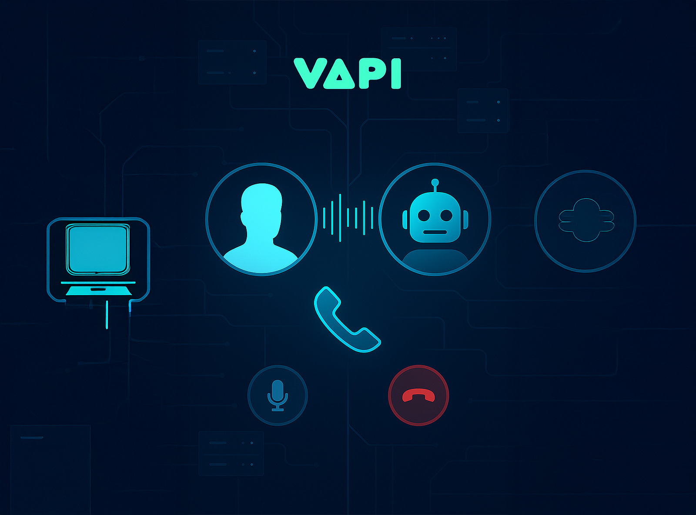
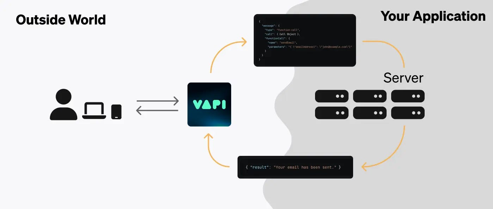
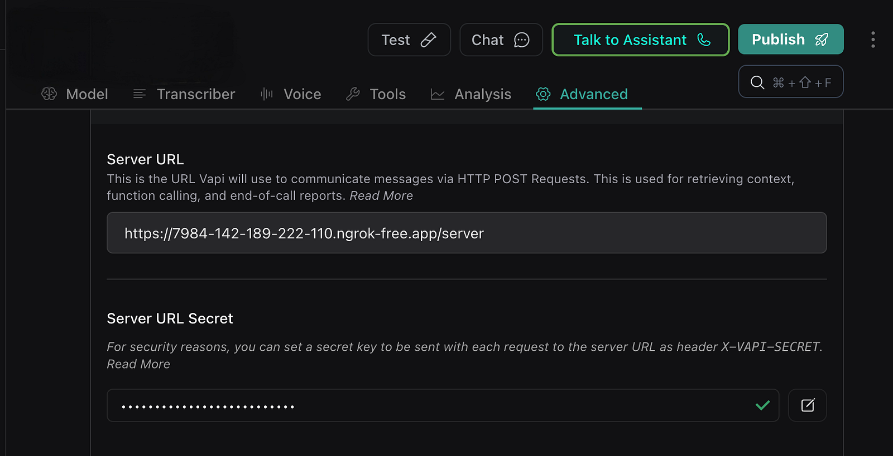
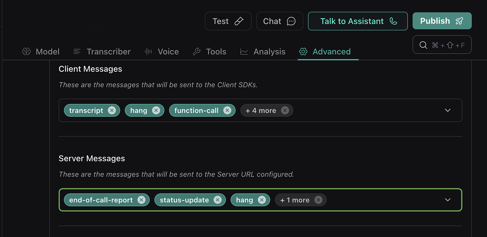

*Fig 1. Human AI Communication (Generated by OpenAI)*

Hi, In recent days we are receiving numerous updates from voice agent platforms like vapi, livekit and many more. I have developed 10+ enterprise grade Voice Agents some with even HIPAA compliance. During this journey, I find that Vapi is more flexible and has many hidden features that some people are not aware of. This blog is not a tutorial or git template for your next project. But, yes I will take you through minimal codebase to understand the workings. I encourage you to be open minded and come up with new ideas, build, ship and share it all and don’t forget to tag me.

## What Server URL is?

[**Vapi AI’s Server *URL***](https://docs.vapi.ai/server-url) feature was launched on March 10, 2025. This functionality allows applications to receive and communicate data with Vapi during conversations by acting as a web hook or API endpoint for various events like status updates, function calls, and end-of-call reports.



*Fig 2. Overview of Server — Vapi — EndUser (Vapi [Docs](https://docs.vapi.ai/server-url))*

Okay, imagine this way your server url keeps listening to every call on live, however you are not listening to every bytes of the call. Your server gets triggered only for the events you are already subscribed this way you don’t live stream call and avoid storing or extra processes. However, due its bidirectional communication capabilities it is called as server and not web hook.

> Note: storing the call locally, can infect HIPAA compliance, read more about it before implementing

## Priority Hierarchy

Vapi allows server URLs to be configured at four distinct levels to handle conversation events with granular control:

### 1. Function Level

The most granular level, where server URLs are assigned to specific function calls within an assistant. This enables targeted event handling for individual functions (e.g., booking or email validation)

### 2. Assistant Level

Server URLs can be set for entire assistants, either during creation or via updates. Configured through the dashboard’s “Advanced” tab or the `assistant.serverUrl` API field

### 3. Phone Number Level

Attached to specific phone numbers when:

- Creating a new Vapi number
- Importing numbers from Twilio/Vonage
- Updating existing numbers via the `phoneNumber.serverUrl` field

### 4. Account/Organization Level

A default server URL set at the account or organization level, used when no higher-priority URLs are specified.

## Types of Server Events

Vapi can send six types of events to configured server URLs during conversations:

1\. Status Updates

2\. Transcript Updates

3\. Function Calls

4\. Assistant Requests

5\. End of Call Report

6\. Hang Notifications

## Sample server in FastAPI

> NOTE: For testing use ngrok to expose to internet

```python
from fastapi import FastAPI, Request
import uvicorn

app = FastAPI()

def handle_function_call(message: dict):
    print("Function call received")
    return {"status": "function-call-received"}

def handle_assistant_request(message: dict):
    print("Assistant request received")
    return {"status": "assistant-request-received"}

@app.post("/server")
async def webhook(request: Request):
    print("Webhook received")
    received_data = await request.json()
    print('\n\n\n\n\n')
    print(received_data)
    print('\n\n\n\n\n')
    message: dict = received_data.get("message", {})
    message_type: str = message.get("type", "")
    if message_type == "function-call":
        return handle_function_call(message)
    elif message_type == "assistant-request":
        return handle_assistant_request(message)
    else:
        return {"status": "received"}
    


if __name__ == "__main__":
    uvicorn.run(app, host="0.0.0.0", port=8001)
```

Once your server is live and is accessible from internet, add the endpoint to the assistant, in the advanced section.



*Fig 3. Vapi Dashboard inside Assistant*

And you can modify the list of events you would like to subscribe from the assistant dashboard, below the server url input box.



*Fig 4. Vapi Dashboard inside Assistant*

Perfect! All set. Now we are completely aware of all events that happens during your Voice AI communications.

------------------------------------------------------------------------

## How can we control now?

The **Call Control URL** feature by Vapi AI was released on September 10, 2024. The one word answer to it is `controlUrl.`whenever you initiate (outbound) a call or a call is received (inbound) a `controlUrl` is generated and is attached to your `callId.`

Subscribe to the event `status-update` so that you will be notified for every event change. So, once, the call is initiated, in the payload you will receive **response\[‘monitor’\]\[‘controlUrl’\]**

So, we have the controlUrl in our hand. Imagine the controlUrl as the key to do any changes or update state in the live call.

The main features of Vapi’s Call Control include:

### 1. Say Message

Makes the assistant say a specific message during the call.

```bash
curl -X POST 'https://aws-us-west-2-production1-phone-call-websocket.vapi.ai/7420f27a-30fd-4f49-a995-5549ae7cc00d/control' 
-H 'content-type: application/json' 
-d '{
  "type": "say",
  "content": "Welcome to Vapi, this message was injected during the call.",
  "endCallAfterSpoken": false
}'
```

### 2. Add Message to Conversation

Adds a message to the conversation history and optionally triggers a response.

```bash
curl -X POST 'https://aws-us-west-2-production1-phone-call-websocket.vapi.ai/7420f27a-30fd-4f49-a995-5549ae7cc00d/control' 
-H 'content-type: application/json' 
--data-raw '{
  "type": "add-message",
  "message": {
    "role": "system",
    "content": "New message added to conversation"
  },
  "triggerResponseEnabled": true
}'
```

### 3. Assistant Control

Control the assistant’s behavior during the call.

```bash
curl -X POST 'https://aws-us-west-2-production1-phone-call-websocket.vapi.ai/7420f27a-30fd-4f49-a995-5549ae7cc00d/control' 
-H 'content-type: application/json' 
--data-raw '{
  "type": "control",
  "control": "mute-assistant"  // Options: "mute-assistant", "unmute-assistant", "say-first-message"
}'
```

### 4. End Call

Programmatically end the ongoing call.

```bash
curl -X POST 'https://aws-us-west-2-production1-phone-call-websocket.vapi.ai/7420f27a-30fd-4f49-a995-5549ae7cc00d/control' 
-H 'content-type: application/json' 
--data-raw '{
  "type": "end-call"
}'
```

### 5. Transfer Call

Transfer the call to a different destination.

```bash
curl -X POST 'https://aws-us-west-2-production1-phone-call-websocket.vapi.ai/7420f27a-30fd-4f49-a995-5549ae7cc00d/control' 
-H 'content-type: application/json' 
--data-raw '{
  "type": "transfer",
  "destination": {
    "type": "number",
    "number": "+1234567890"
  },
  "content": "Transferring your call now"
}'
```

------------------------------------------------------------------------

By, leveraging the capabilities of Server Url and Live Call control in Vapi, you can take complete control of your AI Voice Agents. Hope you find this writeup helpful. Thanks for reading.

Thanks for reading!

Feel free to write to me on [LinkedIn](http://linkedin.com/in/mahimairaja/) 📩

On 8th April, Vapi also released it’s support Model Context Protocol (MCP). And, it opened a gateway to numerous data integrations. The next blog will be related to FastAPI, MCP, and Vapi.

------------------------------------------------------------------------

## References:

1. [Vapi docs](https://docs.vapi.ai/welcome)
