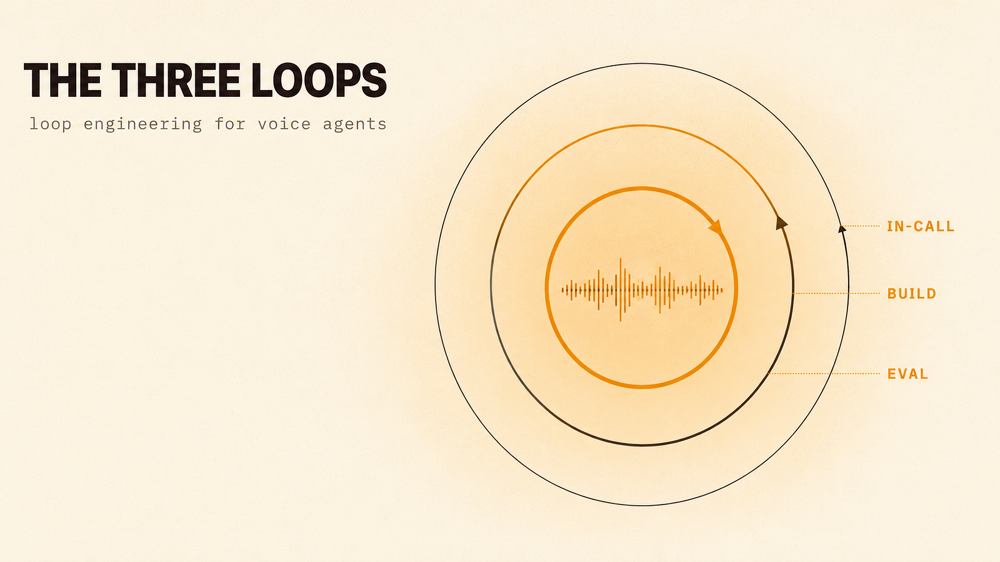
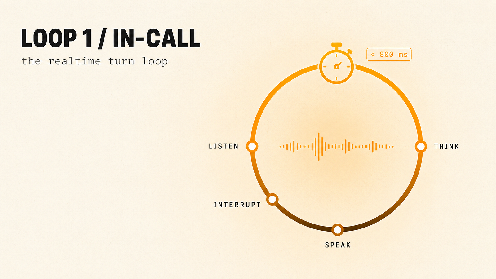
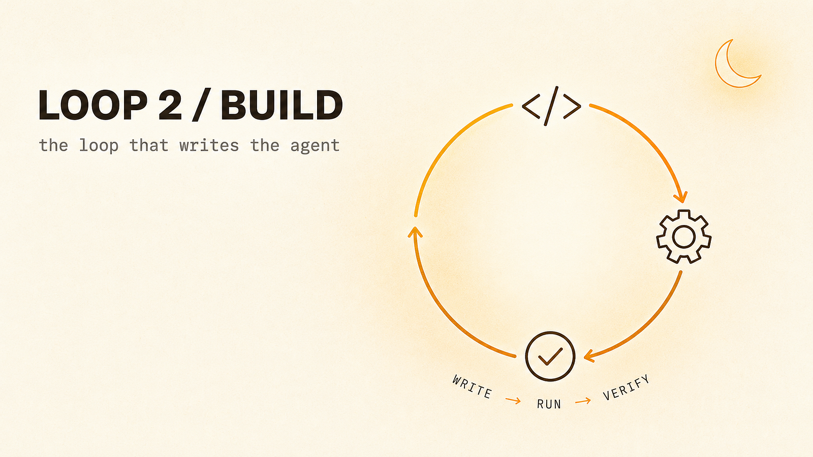
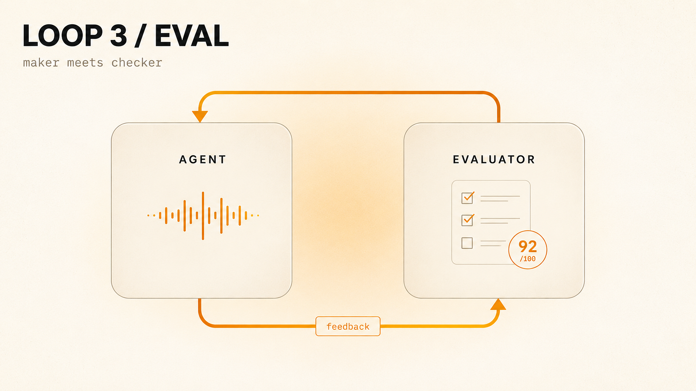

In June 2026, one sentence reorganized how people talk about building with AI. Peter Steinberger, who built OpenClaw, posted that you should stop prompting coding agents and start designing the loops that prompt them. It crossed millions of views in a day. A few days earlier, Boris Cherny, who leads Claude Code at Anthropic, had put it more bluntly: he does not prompt Claude anymore, he writes loops that prompt Claude and decide what to do next. Google’s Addy Osmani gave the idea a name, **loop engineering**, and the term stuck.

> You shouldn’t be prompting coding agents anymore. You should be designing loops that prompt your agents. — [Peter Steinberger](https://x.com/steipete/status/2063697162748260627)

Trust me its not only about coding agents

Every example in that conversation was about code. None of it was about voice. That is strange, because voice agents have been loops the whole time. A chat prompt is a single shot. A phone call is not. A call is a loop that runs until someone hangs up, and it is a harder loop than anything a coding agent runs, because it has a deadline measured in milliseconds and a real person on the other end who hears every mistake the instant you make it.

If you build voice agents, you are already running three loops by hand. Here is what they are, and which ones you should stop running by hand.



## Loop Engineering is …

Strip the hype and the idea is small and durable. Loop engineering is the *practice of designing the system that prompts an agent on a schedule*, instead of typing each prompt yourself. You define a goal, give the agent a way to find the next piece of work, let it act, verify the result, and remember what is already done. Then you let that system drive while you supervise.

The line that captures it best is that a loop is cron plus a decision maker. The model picks the next action on each tick. Nothing is a hardcoded branch. The other half of the idea, the half most people skip, is that feedback is what makes a loop trustworthy. A loop with nothing to push back on it is just the agent agreeing with itself, faster.

There is a clean maturity ladder underneath.

→ Stage one is [prompt engineering](https://cloud.google.com/discover/what-is-prompt-engineering): one instruction, one turn, you in the chair.   
→ Stage two is loop engineering: the agent runs an act, evaluate, improve cycle with a separate evaluator and explicit stopping conditions.   
→ Stage three is orchestrated teams: a coordinator hands work to parallel specialists behind an evaluation gate.

The lineage runs from [ReAct](https://www.ibm.com/think/topics/react-agent) in 2022, through [AutoGPT](https://github.com/significant-gravitas/autogpt) in 2023, through the [ralph loop](https://github.com/snarktank/ralph) in 2025, to the native goal loops shipping in coding tools this spring.

Notice what every stage and every example has in common. It is all framed around code. That framing is the gap, and voice is sitting in it.

## I. The in-call loop you have always run



A voice agent is a pipeline that runs in a circle. It listens, it decides whether the speaker is actually done, it thinks, it speaks, and then it immediately starts listening again for the interruption. That circle is the **in-call loop**, and it runs on every call you have ever shipped, whether or not you ever called it a loop.

In LiveKit Agents this loop lives inside the AgentSession lifecycle. You wire up the parts, speech to text, an LLM, text to speech, and a voice activity detector, and the session runs the cycle for you. Conceptually it looks like this:

```python
while call_is_active:
    audio  = listen()          # VAD decides speech vs silence
    if user_started_talking:
        stop_speaking()        # interruption handling
    done   = endpoint(audio)   # has the user actually finished?
    if not done:
        continue
    intent = think(audio)      # LLM, often a tool loop of its own
    reply  = speak(intent)     # TTS
    play(reply)                # then immediately watch for the next barge-in
```

Two parts of that loop are where voice gets hard. The first is [**turn detection**](https://docs.livekit.io/agents/logic/turns/), the decision about whether the user has actually finished talking, which is distinct from voice activity detection that only decides whether sound is currently speech. Get turn detection wrong and the agent either talks over the user or sits in silence waiting for a sentence that already ended. The second is the deadline. A user who waits a second and a half for a chat reply feels nothing. The same wait on a call feels like the line dropped. Latency in this loop is cumulative across every stage, and it is a hard constraint, not an optimization you get to defer.

There is also a loop inside this loop. When the LLM calls a tool, checks an order status, books a slot, queries a knowledge base, it runs its own small reason-and-act cycle before it produces a single spoken word. So the in-call loop is really a fast outer loop wrapped around a smaller reasoning loop, and both have to finish before the caller notices the pause.

This is the one loop the coding world cannot hand you a playbook for. Their loops run for minutes while you sleep. Yours runs in under a second while someone waits, and there is no undo on a sentence the agent has already said out loud.

------------------------------------------------------------------------

## II. The Build Loop that writes the agent



The second loop is the one the June 2026 conversation was actually about, and if you build voice agents with a coding agent in the loop, you are already running it. You write a goal and a set of constraints, the agent finds the next unit of work, edits the code, runs the tests, reads the result, and goes again. This is the **build loop**, and a ralph-style prompt driving Claude Code is one concrete shape of it.

For voice work the build loop is genuinely good at the parts that are mechanical: scaffolding a new agent from a working template, wiring a new tool into the session, adding a provider behind your inference router, writing the boring integration glue between your telephony layer and your agent process. You define the goal once and let the loop converge while you do something else.

The honest tradeoff is specific to voice, and it is sharp. A coding loop verifies itself with tests and type checks. Those catch a function that throws. They do not catch a tool definition that is plausibly wrong, a system prompt that produces a subtly rude greeting, or a turn-taking config that feels fine in a unit test and feels broken on a real call. The build loop will hand you green checks and a voice agent that says the wrong thing politely. The failure mode is not a crash. It is a confident, well-tested mistake that only a human ear, or the third loop, will catch.

So the rule for the build loop in voice is the same rule as in code, with higher stakes: the loop is only as trustworthy as the thing checking its work. Tests are a weak check for a system whose output is spoken. You need a stronger one.

------------------------------------------------------------------------

## III. The Eval loop



This is the loop most voice teams run least, and it is the one that decides whether the other two are safe. The **eval loop** is the act, evaluate, improve cycle pointed at your agent’s actual behavior. You generate call scenarios, run them through the agent, score what comes back on transcript quality, latency, and task success, feed the failures back, fix, and run it again.

The principle underneath it is the one piece of loop engineering that transfers to voice without modification: the evaluator has to be structurally separate from the thing it evaluates. A voice agent cannot grade its own calls, for the same reason a loop with no external check just agrees with itself. You need a second system whose only job is to judge, and that system has to be able to say no.

In practice this looks like a simulation harness that places synthetic calls against your agent, paired with an evaluator that scores each one against criteria you defined in advance. [Cekura](https://www.cekura.ai/) is one tool built for exactly this: simulated calls, scenario coverage, and automated scoring of the transcripts. It slots into the maker-checker split cleanly, the agent is the maker and the eval system is the checker. The specific tool matters less than the shape. The shape is not optional.

What you score is where voice diverges from code. A coding eval checks whether the output compiles and passes. A voice eval has to check things that do not reduce to pass or fail: did the agent interrupt the caller, did it recover when the transcript came back garbled, did it stay on task when the caller went off script, did time to first response stay under budget across the whole call and not just on average. These are graded judgments, often made by a stronger model acting as a judge, and sometimes spot-checked by a person.

Done well, the eval loop is what lets you trust the build loop. You let the build loop ship changes fast precisely because the eval loop is standing behind it, replaying a library of hard calls against every change and refusing the ones that regress. Without it, a fast build loop is just a faster way to ship a confident mistake into a phone line.

## where the loop should not run alone

Loop engineering carries a quiet assumption from its origin in coding: that you can let the loop run unattended. Boris Cherny runs his loops on a schedule and checks the results later. That is reasonable when the blast radius is a sandboxed repository and the worst case is a bad commit you revert. It is reckless when the blast radius is a live caller, and sometimes a real transaction: a refund issued, an appointment moved, a medication question answered.

This is the line that separates voice from the coding hype. Two of your three loops, the build loop and the eval loop, are offline. They run against code and against simulated calls, and the autonomy the June 2026 discourse celebrates belongs there. The third loop, the in-call loop, runs against a person in real time, and full autonomy there is not a productivity win. It is an incident waiting for a transcript.

The in-call loop needs its own version of what coding people call **loop-breakers**: explicit conditions that stop the cycle before it does damage. In code those are an iteration cap, a no-progress detector, and a dollar budget. In voice they are concrete and human. A cap on how many times the agent re-asks before it hands off to a person. A timeout on a turn that has gone quiet. A hard fallback path when a tool call fails twice, instead of a third retry the caller has to sit through. A clear rule for when the agent stops trying to resolve and escalates.

The teams that get this right do not chase a fully autonomous agent on the call. They engineer the offline loops hard, the build loop and the eval loop, where iteration is cheap and mistakes are private, and they keep firm, boring guardrails on the loop that touches a human. That is not a limitation to apologize for. It is the design.

## Take away

The shift the coding world is naming is real: the leverage is moving from the prompt you type to the loop you design. The part the conversation has missed is that voice engineers have been doing the hardest version of this all along, because one of their loops has a deadline and a human in it.

You are running three loops. The in-call loop has run on every call you ever shipped, and it is the one to leave mostly alone: fast, well instrumented, and fenced with guardrails. The build loop is the one the rest of the industry just discovered, and it will ship your mechanical work fast as long as you do not trust its green checks. The eval loop is the one to build next if you have not, because it is what makes the other two safe to run.

Stop hand-running the two that should be loops. Keep your hands close to the one that should not.

------------------------------------------------------------------------

*I write about voice AI like this every day as part of my \#100DaysOfVoiceAI series. If you build voice agents, I am curious about one thing: which of your three loops is the least engineered right now, and what is stopping you from closing it?*
